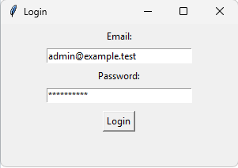
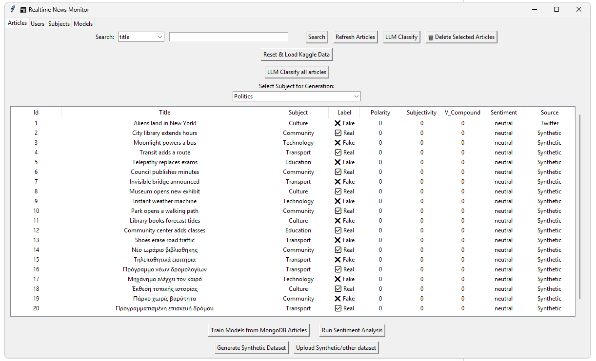
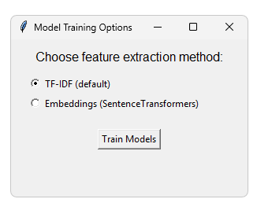
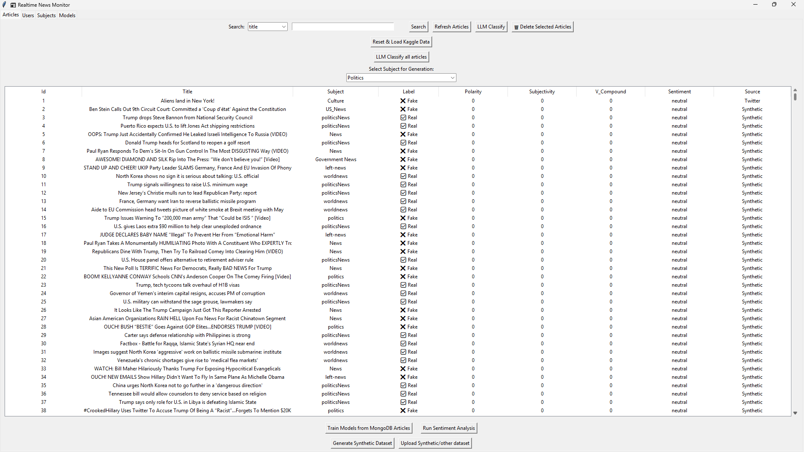
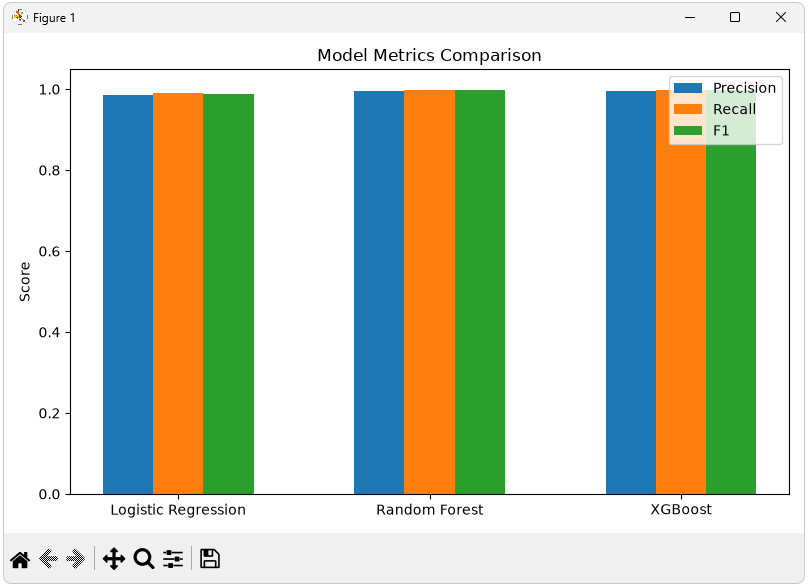
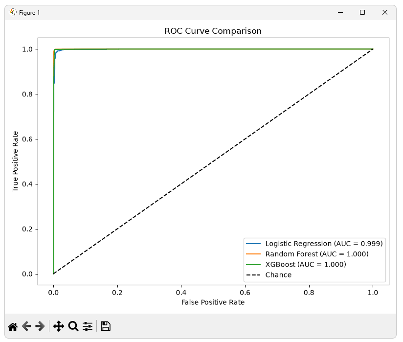
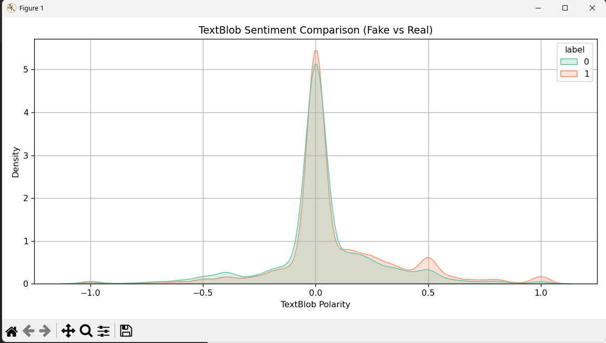
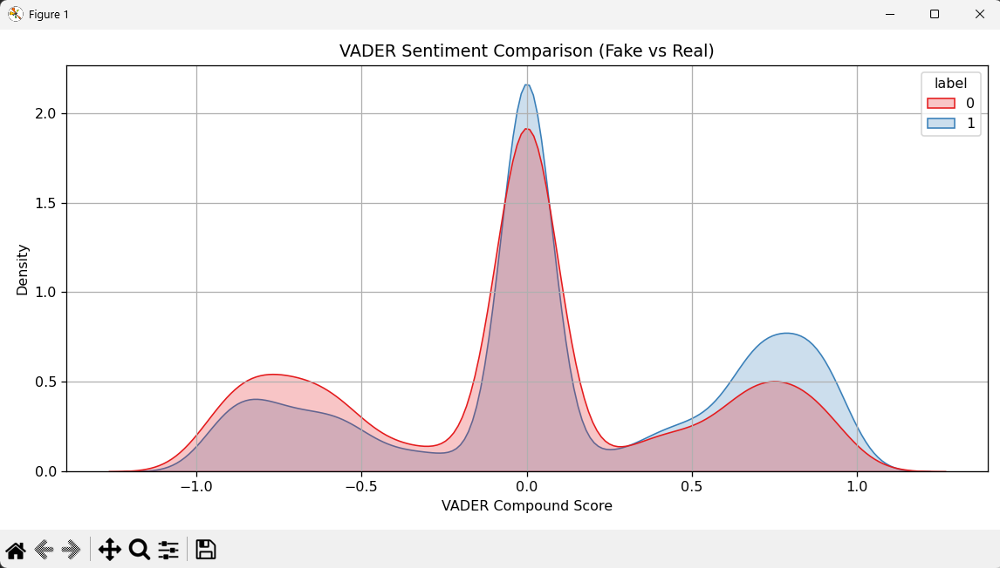

# Fake News Detection

I worked on this project for the Advanced Data Management course at the University of Thessaly in 2024–25. We explored how classical machine learning models and pretrained transformers classify English-language news articles as **real** or **fake**. I used TF-IDF and Sentence-BERT to represent the text and explored sentiment patterns with TextBlob and VADER. This GitHub version includes a Tkinter desktop app that uses MongoDB to store, browse, and filter labeled articles. From the app, users can train classifiers on selected articles and run predictions with pretrained transformers.

## What the project covers

| Component | Implementation |
| --- | --- |
| Data ingestion | Import labeled CSVs into MongoDB |
| Classical ML | Compare logistic regression, random forest, and XGBoost with TF-IDF. Compare logistic regression and random forest with Sentence-BERT embeddings |
| Evaluation | Stratified 80/20 holdout, five-fold stratified cross-validation, confusion matrices, F1, and ROC AUC |
| Transformer inference | Run pretrained BERT, BART, RoBERTa, or prompt-based FLAN-T5 on individual articles or a collection |
| Dataset generation | Generate semi-synthetic English articles with NewsAPI and GPT-2 |
| Sentiment exploration | Inspect TextBlob and VADER scores alongside article labels |

## Run the desktop demo

Use Python 3.11, Tkinter, and a local MongoDB server listening on `127.0.0.1:27017`. Use a disposable local MongoDB instance for the demo. The application uses the `realtime_news_db` database and seeds a local demo login.

Download and extract the repository or clone it. Open a terminal in the folder containing `requirements.txt`. On Windows, run the following commands one at a time in Command Prompt. The virtual environment lives inside the project folder.

```cmd
dir requirements.txt
py -3.11 -m venv .venv
.venv\Scripts\python.exe -m pip install -r requirements.txt
.venv\Scripts\python.exe -m nltk.downloader stopwords vader_lexicon
.venv\Scripts\python.exe setupDB.py
.venv\Scripts\python.exe setup_realtime_news_db_1.py
```

Run `setupDB.py` once on a fresh demo database. If it reports that collections already exist and you previously initialized this demo, launch the app directly. Use a separate local MongoDB instance if the existing database contains data you want to keep.

On macOS or Linux with Python 3.11 and Tkinter, create the environment with `python3.11 -m venv .venv` and use `.venv/bin/python` in place of the Windows interpreter path above.

1. Sign in as `admin@example.test` with password `local-demo`.

   

2. Use **Upload Synthetic/other dataset** and select [examples/demo_articles.csv](examples/demo_articles.csv).

   

3. Use **Train Models from MongoDB Articles** and choose **TF-IDF**. Close the metrics and ROC plot windows to return to the app.

   

4. To try pretrained inference, select or enter an article title and click **LLM Classify**, choose a model, and click **Instant Classify Article**. The first use downloads the selected model. Sentence-BERT training also downloads a model on first use.

The example CSV contains invented English and Greek text, with ten rows per class. Its labels are for exercising ingestion and training. Any scores from this sample are smoke-test output. The **Reset & Load Kaggle Data** button clears the demo collections after confirmation.

## App tabs and controls

| Tab | Control | What it does |
| --- | --- | --- |
| Articles | **Search**, **Refresh Articles** | Search by title, subject, sentiment, or source. Refresh restores the full list. Click a column header to sort or double-click a row to copy its title into the search box. The search menu also lists label and confidence, but the current text search does not reliably filter those numeric fields. |
| Articles | **Upload Synthetic/other dataset** | Imports a labeled CSV into MongoDB. The generic importer displays `Synthetic` as the source. |
| Articles | **Select Subject for Generation**, **Generate Synthetic Dataset** | Chooses a topic and writes a semi-synthetic CSV using NewsAPI and GPT-2. Set `NEWSAPI_KEY` before launching, then import the generated CSV using the upload button. |
| Articles | **Reset & Load Kaggle Data** | Asks for confirmation, clears the demo collections, and loads the local combined Kaggle CSV. Use this on a disposable demo database. |
| Articles | **Train Models from MongoDB Articles** | Trains on articles matched to the titles currently shown in the table. **TF-IDF** trains Logistic Regression, Random Forest, and XGBoost. **Embeddings (SentenceTransformers)** trains Logistic Regression and Random Forest. |
| Articles | **Run Sentiment Analysis** | Runs TextBlob and VADER on the MongoDB article collection, writes the scores back to MongoDB, and exports `fakenews_datasets/sentiment/articles_sentiments.csv`. |
| Articles | **LLM Classify** | Classifies the title in the search box and displays the prediction. The dialog offers BERT, FLAN-T5, BART, and RoBERTa. The full-text checkbox is present, but this single-article action currently uses only the title. |
| Articles | **LLM Classify all articles** | Offers the same four models and runs over eligible labeled articles in MongoDB. **Use full text** adds the body to the title. The app saves predictions separately from dataset labels and prints an evaluation summary. |
| Articles | **Delete Selected Articles** | Deletes selected records from MongoDB by matching their titles. Titles can be ambiguous when duplicates exist. |
| Users | **Add User**, **Delete Selected User**, **Refresh** | Lists user records. Add a name, email, and role (user, moderator, or admin), delete the selected record, or reload the list. Adding a record through this form does not set a login password. |
| Subjects | **Add Subject**, **Delete Selected**, **Refresh Subjects** | Manages the stored subject list used for synthetic generation. |
| Models | **Delete Selected Model** | Lists saved model records with their timestamps and feature types. Delete targets the MongoDB record. It does not remove the local model file, and records saved with full paths may fail to match the filename shown in the table. |

## Use your own data

- **CSV import.** Supply UTF-8 `title`, `text`, and `label` columns. Use `0` for fake and `1` for real. You can also provide `subject` and `date`. The GUI applies minimum text lengths and expects at least five usable rows per class to train.
- **Optional generation.** Set `NEWSAPI_KEY` before launching the desktop app for English generation. This requires network access. The original datasets and model artifacts are kept outside Git.

## Repeat the Kaggle experiment

1. Download `Fake.csv` and `True.csv` from the [Fake and Real News Dataset](https://www.kaggle.com/datasets/clmentbisaillon/fake-and-real-news-dataset) and put them in `fakenews_datasets/Kaggle/` inside the repository. Create those folders if needed.
2. From the repository root, combine and shuffle the source CSVs with a fixed seed. This writes `AllNews_Kaggle.csv` with labels `0 = fake` and `1 = real`.

   ```cmd
   .venv\Scripts\python.exe -c "import pandas as pd; from pathlib import Path; p = Path('fakenews_datasets/Kaggle'); fake = pd.read_csv(p / 'Fake.csv').assign(label=0); real = pd.read_csv(p / 'True.csv').assign(label=1); pd.concat([fake, real], ignore_index=True).sample(frac=1, random_state=42).to_csv(p / 'AllNews_Kaggle.csv', index=False)"
   ```

3. In the app, click **Reset & Load Kaggle Data** on a disposable demo database. The button clears the existing demo collections and loads up to 45,000 rows from the combined CSV. Sign in again if prompted.
4. Set the search field to **source**, enter `Kaggle`, and click **Search**. Then choose **Train Models from MongoDB Articles → TF-IDF**. This limits the training selection to Kaggle rows. The terminal prints classification reports, holdout ROC AUC, and five-fold cross-validation F1. Close each plot to continue.



*The screenshot shows `AllNews_Kaggle.csv` loaded through **Upload Synthetic/other dataset**. That uploader displays `Synthetic` in the Source column. The dedicated Kaggle loader in step 3 uses `Kaggle`.*

The training code uses a stratified 80/20 split and stratified five-fold cross-validation, both with seed `42`. In the printed binary F1 scores, class `1` is the positive class. Record the commit, dataset files, selected model option, and installed package versions alongside any numbers you report. The dependency file is unpinned, and exact agreement with the original e-class metrics has not been verified. The [FakeNewsNet sentiment results](#sentiment-analysis-on-fakenewsnet) below come from a separate coursework run.

### Example TF-IDF training results

In one Windows run after importing `AllNews_Kaggle.csv`, the app trained **Logistic Regression**, **Random Forest**, and **XGBoost** in a few minutes. Allow more time for larger datasets or slower hardware. Close each plot window to let the desktop workflow finish.





The ROC legend displays AUC values of **0.999** for Logistic Regression and **1.000** for both Random Forest and XGBoost, rounded to three decimals. These scores come from a random holdout in this run. The evaluation did not measure performance on new publishers or articles collected later.

Training saves `log_model.pkl`, `rf_model.pkl`, and `xgb_model.pkl` in `fakenews_datasets/models/` on your machine.

## Sentiment analysis on FakeNewsNet

In the original coursework run, we compared TextBlob polarity and VADER compound scores across 21,847 FakeNewsNet records. The labels in the plots are `0 = fake` and `1 = real`.

| Sentiment score | KS statistic | ROC AUC using the score alone |
| --- | ---: | ---: |
| TextBlob polarity | 0.0808 | 0.5514 |
| VADER compound | 0.1077 | 0.5718 |

Both methods show substantial overlap between the two classes, especially around neutral sentiment. VADER separated the classes slightly better on this dataset, but both AUC values were close to 0.50, the chance baseline for ranking. These results describe the sentiment scores alone.





## Interpreting the output

The evaluation measures agreement with dataset labels on a random split. Publisher patterns, duplicate coverage, and generated text can make these scores optimistic for unseen sources. The coursework uses English-oriented preprocessing and sentiment tools. The demo checks that Greek text can be imported. The coursework did not establish Greek classification accuracy. Treat predictions as model outputs. Verifying a real-world claim requires independent evidence.

## Credits

Nikolas Kousoulis. 
This was a project I created while attending the course 'Advanced Data Management' of the Department of Electrical and Computer Engineering.

## License

See [LICENSE](LICENSE) for the MIT license. Third-party datasets, models, and dependencies have their own terms.
